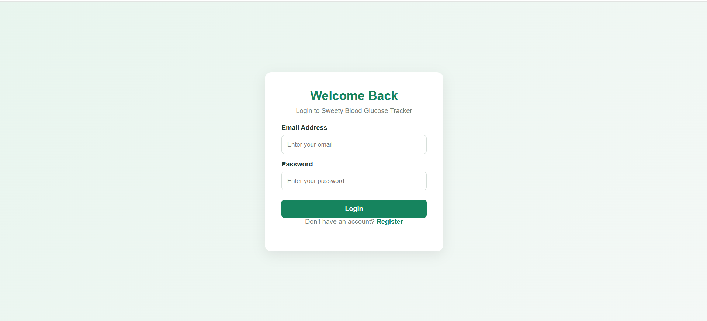
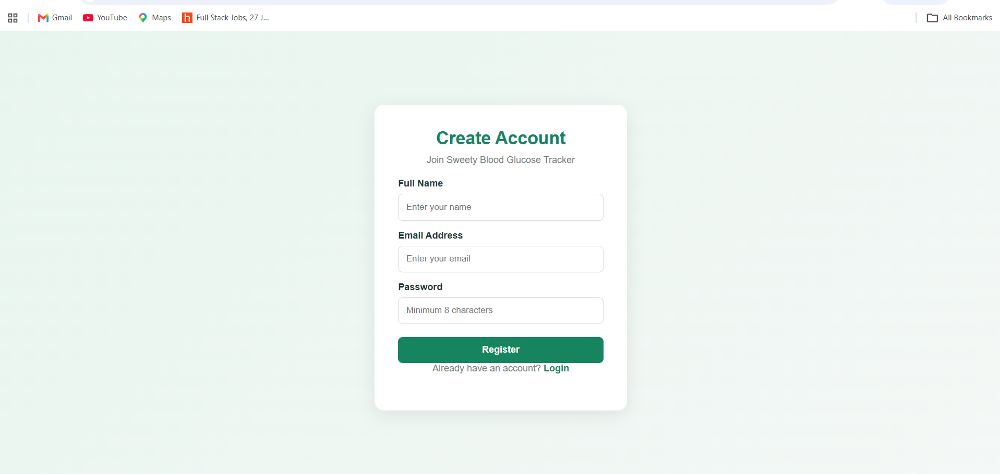
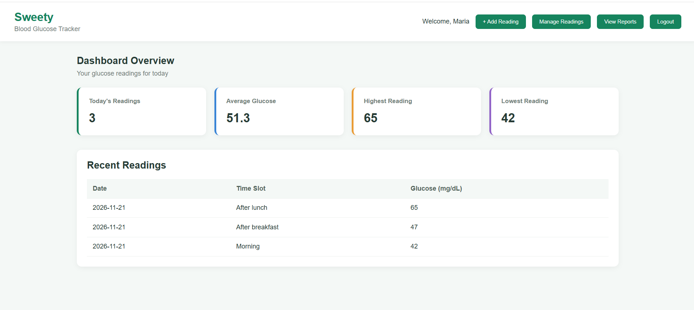
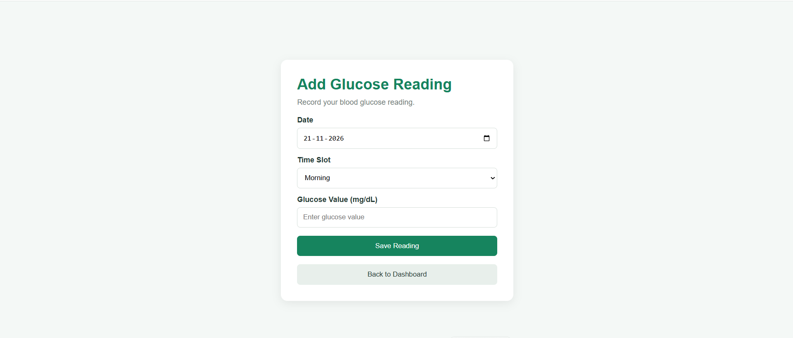
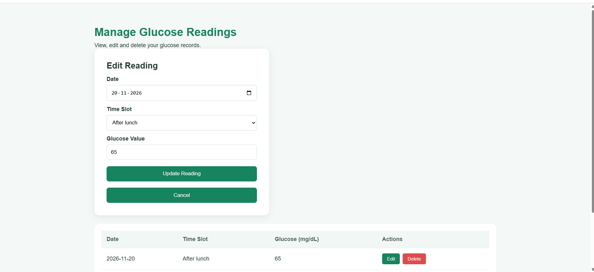
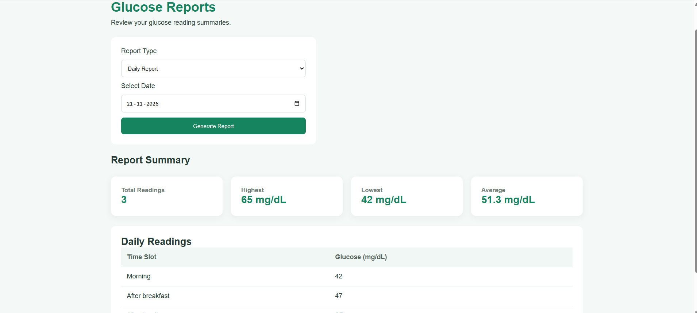
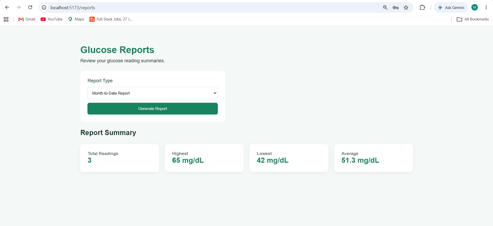

\# Sweety – Blood Glucose Tracker

A full-stack web application that helps users record, manage, and monitor their daily blood glucose readings.

\## Features

\- User registration and login

\- Secure password hashing using bcrypt

\- JWT-based authentication

\- Add, view, edit, and delete glucose readings

\- Four daily reading slots:

&#x20; - Morning

&#x20; - After breakfast

&#x20; - After lunch

&#x20; - After dinner

\- Glucose validation (40–600 mg/dL)

\- Prevent duplicate readings for the same slot and date

\- Prevent future-dated readings

\- Daily glucose reports

\- Month-to-date reports

\- Previous-month reports

\- High, low, average, and reading count statistics

\- User-specific data access

\## Technology Stack

\*\*Frontend\*\*

\- React

\- React Router

\- Axios

\- CSS

\*\*Backend\*\*

\- Node.js

\- Express.js

\- PostgreSQL

\- pg

\- JWT

\- bcryptjs

\## Project Structure

```text

Sweety-Blood-Glucose-Tracker/

├── backend/

│   ├── config/

│   ├── controllers/

│   ├── middleware/

│   ├── routes/

│   ├── scripts/

│   ├── tests/

│   ├── .env.example

│   ├── package.json

│   └── server.js

├── frontend/

│   ├── src/

│   │   ├── components/

│   │   ├── context/

│   │   ├── pages/

│   │   └── services/

│   └── package.json

├── .gitignore

└── README.md

```

\## Installation and Setup

\### 1. Clone the repository

```bash

git clone https://github.com/Maria-melwin/Sweety-Blood-Glucose-Tracker.git

cd Sweety-Blood-Glucose-Tracker

```

\### 2. Backend setup

```bash

cd backend

npm install

```

Create a `.env` file using `.env.example` and configure your PostgreSQL credentials and JWT secret.

\### 3. Database setup

Create a PostgreSQL database named `sweety\_db`.

Create the required `users` and `readings` tables using the database SQL scripts.

\### 4. Start the backend

```bash

node server.js

```

Backend runs at:

`http://localhost:5000`

\### 5. Frontend setup

Open another terminal:

```bash

cd frontend

npm install

npm run dev

```

Frontend runs at:

`http://localhost:5173`

\## API Endpoints

| Method | Endpoint | Description |

|---|---|---|

| POST | `/api/auth/register` | Register a user |

| POST | `/api/auth/login` | Login |

| GET | `/api/readings` | Get readings |

| POST | `/api/readings` | Add reading |

| GET | `/api/readings/:id` | Get reading by ID |

| PUT | `/api/readings/:id` | Update reading |

| DELETE | `/api/readings/:id` | Delete reading |

| GET | `/api/reports/daily` | Daily report |

| GET | `/api/reports/month-to-date` | Month-to-date report |

| GET | `/api/reports/previous-month` | Previous-month report |

Reading and report endpoints require JWT authentication.

\## Validation Rules

\- Glucose values must be integers between 40 and 600 mg/dL.

\- Only four predefined time slots are accepted.

\- Only one reading is allowed per user, date, and time slot.

\- Future dates are not allowed.

\- Users can access only their own readings.

\## Author

Maria Melwin

\## GitHub Repository

https://github.com/Maria-melwin/Sweety-Blood-Glucose-Tracker

## Application Screenshots

### Login Page



### Registration Page



### Dashboard



### Add Glucose Reading



### Readings Management



### Daily Report



### Monthly Report


